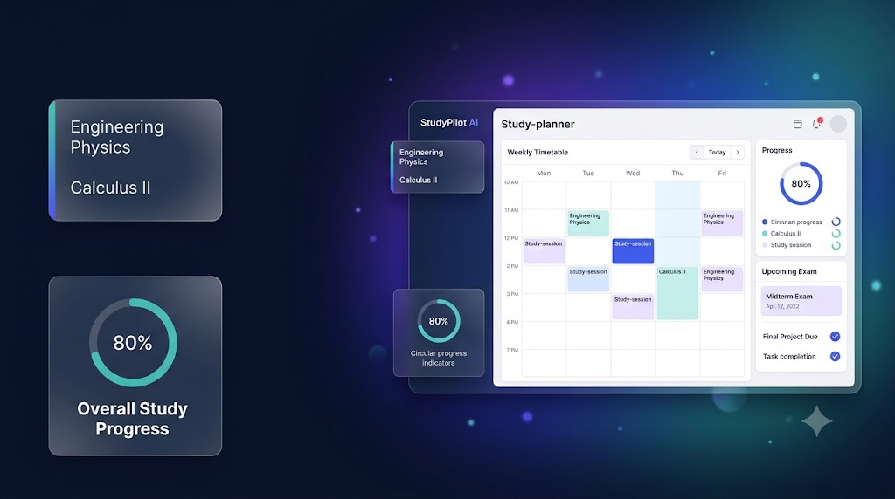
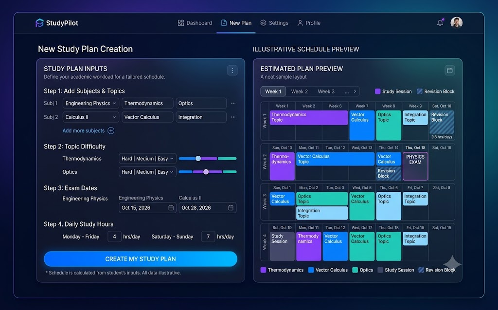
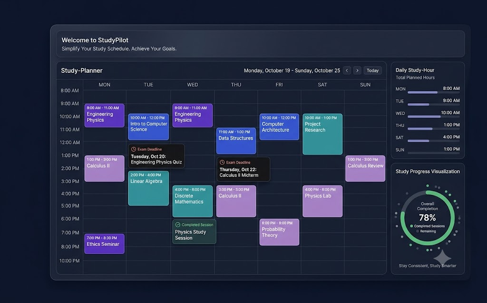
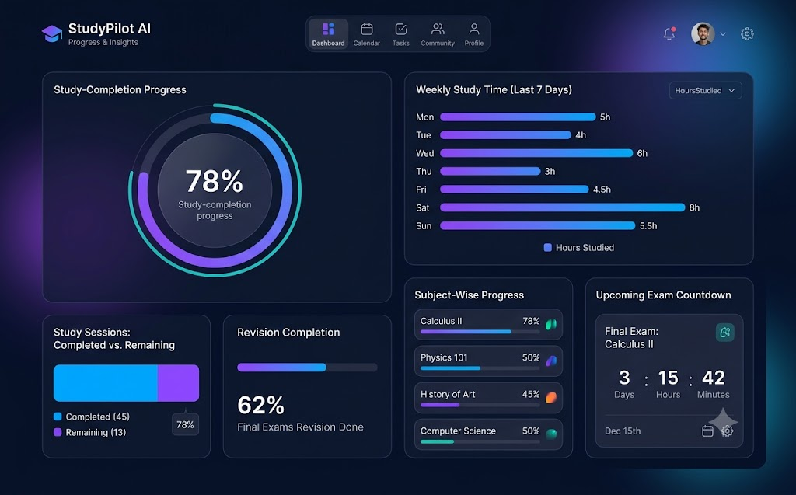

<div align="center">
  <h1>StudyPilot AI</h1>
  <p><strong>Turn exam prep into a plan you can follow.</strong></p>
  <p>Build a practical timetable from your subjects, topics, exam dates, and available study time.</p>
  <p>
    
    
    
    
    
  </p>
  
</div>

**StudyPilot AI** is a student-focused study planning dashboard designed to simplify semester preparation and competitive exam study. It helps students organize subjects and topics, generate structured study timetables based on exam dates, difficulty levels, and daily availability, manage revision sessions, reschedule unfinished tasks, and track study progress and streaks. Built with React, TypeScript, and Vite, it uses a deterministic scheduling engine and browser local storage to provide a practical, privacy-friendly study management experience without relying on external AI APIs.

## 🎓 StudyPilot AI

- **Purpose:** Helps college students organize semester and competitive exam preparation.
- **Smart Study Planning:** Generates a structured timetable from subjects, topics, exam dates, difficulty levels, and daily study availability.
- **Timetable Management:** View sessions by day, mark tasks complete, and reschedule unfinished sessions.
- **Progress Tracking:** Monitor plan completion, study streaks, and estimated workload.
- **Subject Management:** Organize topics with estimated study durations and revision sessions.
- **Personalized Availability:** Adjust daily study hours to fit your schedule.
- **Technology:** React, TypeScript, Vite, and browser local storage.
- **Planning Engine:** Deterministic scheduling; no external AI model or AI API is used.
- **Privacy:** Study-plan data is saved locally on the device.

### 🚀 Live Dashboard

**[Open StudyPilot AI Dashboard](https://studypilot-ai-delta.vercel.app)** — Try the live application.

## ✅ Verified Features

The following features were exercised in the deployed dashboard:

- **Study timetable:** View scheduled study sessions by day.
- **Session completion:** Mark a study session complete and see progress update.
- **Rescheduling:** Move an eligible unfinished session to a suggested available slot.
- **Subject details:** Review topics, difficulty levels, and estimated durations.
- **Progress & Insights:** View plan completion, study streak, and scheduled workload.
- **Daily availability:** Update the daily study-time limit through Settings.
- **Local persistence:** The app indicates that your plan is saved on your device.

> **Planning approach:** StudyPilot uses deterministic scheduling based on user inputs. It does not call an AI model or external AI API.


## Plan around your studies

Add subjects and topics, choose a difficulty for each topic, set exam dates, and enter the time you can study each day. StudyPilot estimates the workload and schedules study and revision sessions before the related exams.

<div align="center">
  
  <p><em>Planning concept artwork. The working setup form uses your own inputs; the illustration is not the app UI.</em></p>
</div>

### Review and adapt the timetable

View sessions in a day-by-day list or calendar. Mark planned sessions complete, or reschedule eligible unfinished work into a suggested available slot. Completed sessions stay completed. If all requested work cannot fit before the exam dates, the planner explains the conflict instead of silently dropping sessions.

<div align="center">
  
  <p><em>Timetable concept artwork. The current app offers List and Calendar views; this is not a screenshot.</em></p>
</div>

### See progress from saved sessions

The Overview highlights the next planned session and upcoming exams. Progress & Insights derives completion, workload, weekly study time, and subject summaries from the saved plan.

<div align="center">
  
  <p><em>Progress concept artwork. Its displayed values are examples, not live user metrics.</em></p>
</div>

## How the planner works

1. **Add your study inputs.** Enter one or more subjects, topics, topic difficulty, exam dates, and daily study availability.
2. **Review the estimates.** Topic estimates are 30 minutes for easy, 45 for medium, and 60 for hard. The planner adds one 30-minute revision estimate per subject.
3. **Generate a timetable.** The deterministic scheduler orders work around exam dates and difficulty, respects daily study limits, and starts suggested study blocks at 9:00 AM. These are estimates, not personalized recommendations.
4. **Study and adjust.** Complete sessions, review data-derived insights, and choose a valid suggested slot when rescheduling unfinished work.

## Tech stack

| Area | Technology |
| --- | --- |
| UI | React 19.3.1 |
| Language | TypeScript 7.0.2 |
| Development and production build | Vite 8.3.5 |
| Unit tests | Vitest 5.0.5 |
| Plan persistence | Browser `localStorage` |

## Run locally

**Requirements:** Node.js 20.19+ or 22.12+, and npm. In PowerShell, use `npm.cmd` if your execution policy blocks the `npm.ps1` shim.

```powershell
npm.cmd ci
npm.cmd run dev
```

Open the local URL printed by Vite, usually `http://localhost:5173/`. Stop the development server with `Ctrl+C`. In other terminals, the equivalent commands are `npm ci` and `npm run dev`.

## Test and build

```powershell
npm.cmd run test
npm.cmd exec tsc -- --noEmit
npm.cmd run build
```

The tests cover scheduling, validation, statistics, local storage, and daily study-time parsing. The production build runs TypeScript checking and Vite. There is no automated browser end-to-end test.

## Project documentation and Skill Pack

The planning and build artifacts are part of the project:

- [Project scope](devpost/scope.md)
- [Product requirements](devpost/prd.md)
- [Technical specification](devpost/spec.md)
- [Build checklist](devpost/checklist.md)
- [App map](devpost/app-map.html)
- [Demo cue sheet](devpost/demo-script.md)
- [Submission checklist](devpost/submission-checklist.md)

This project uses the [Devpost Learn AI Basics Skill Pack](https://github.com/challengepost/learn-ai-basics). Its local copies are in [`.agents/skills/`](.agents/skills/) and [`agent/skills/`](agent/skills/); the installed versions are recorded in [`skills-lock.json`](skills-lock.json).

## Project structure

```text
src/
  components/   Setup form, timetable, insights, and dashboard views
  context/      Shared study-plan state
  lib/          Deterministic planner, statistics, and local storage
  types/        Study-plan data types
public/images/  README concept artwork
devpost/        Planning, build, demo, and submission documents
.agents/skills/ Installed Devpost Learn skills
agent/skills/   Skill Pack copy
```

## Limitations and privacy

- Plans are stored in this browser's `localStorage`. There is no account, backend, cloud backup, or cross-device sync. Clearing browser site data may remove a plan.
- Study durations and suggested times are estimates. StudyPilot is not a live AI service and does not provide personalized advice.
- The artwork in this README is illustrative and does not depict the current application screens or real user data.
- Narrow-screen layout, keyboard-only interaction, reduced-motion behavior, and refresh persistence still need hands-on browser verification.
- The hosted dashboard is available at https://studypilot-ai-delta.vercel.app. For local development, follow the instructions above.

## Contributing

When contributing from a public copy of the repository, open an issue first for a substantial change and use a pull request for review. Keep planning behavior deterministic, preserve completed-session and exam-date constraints, and add or update tests for planner changes. Before opening a pull request, run the test and build commands above and describe what you verified.

## License

StudyPilot AI is released under the [MIT License](LICENSE).
